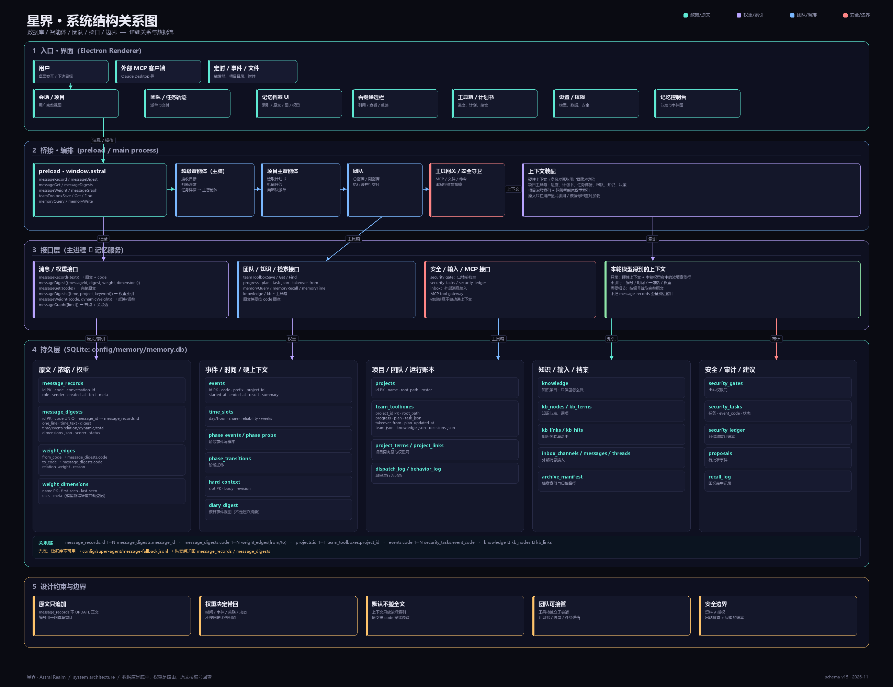
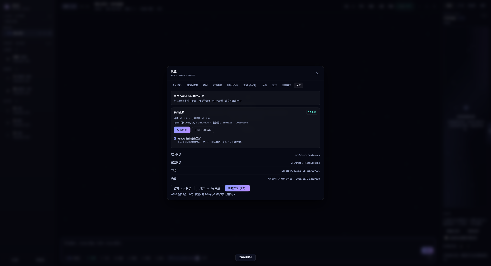

# 星界 · Astral Realm · 超级智能体试运行 / Super Agent Preview

多 Agent、多模型的协作工作台。你划分编制，它们各司其职。

不是「一个万能助手」，而是一支**你可以任免、可以改组、可以换模型**的队伍。

**可编组、可换模型、可共享上下文的 AI 协作桌面。** 总指挥拆解目标，成员并行执行，右侧任务轨迹实时展示每一步交付；单独对话、团队协作、插件制作三种会话彼此隔离。


 

[简体中文](#它是什么) · [English](#english)

## English

**Astral Realm** is a multi-agent, multi-model desktop workspace. You define a team; the commander breaks a goal into tasks, deputies and executors work in parallel, and the task trail shows each delivery in real time.

- Multi-agent roster: commander, deputies, and executors, all editable.
- Per-member models, prompts, skills, and context.
- Solo, team, and plugin conversations are isolated.
- Task trail, Markdown tables, copyable code blocks, and Mermaid diagrams.
- Context-aware prompt enhancement and in-app skill management.
- Themes, MCP tools, plugins, and prompt customization.
- Lightweight: zero-build frontend, Electron shell, MIT license.

Read the Chinese introduction below, or switch the app language in **Settings → Appearance → Interface language**.

---

## 它是什么

主流 Agent 工具给你一个输入框和一个全能的 AI。星界给你的是**编制**：

- 你可以有 1 个总指挥、若干副指挥、若干执行者，也可以只要一个光杆司令。
- 每个成员独立绑定模型、独立提示词、独立技能、独立上下文。
- 用户下达指令 → 总指挥拆解 → 派单给副指挥 / 执行者 → 收齐交付 → 汇总成最终答复。
- 任何一个成员都可以被单独叫出来直聊（左侧点选，或 `@名字`）。

## 系统结构关系图



这张图把“谁在做事、数据存在哪、接口怎么流动、边界在哪”画在同一张图上：

- **入口 · 界面**：用户、外部 MCP 客户端、定时/事件/文件进入桌面界面；会话、任务轨迹、记忆档案、右键候选栏、工具箱与设置都在 Renderer。
- **桥接 · 编排**：`window.astral` 与 IPC 把界面接到主进程；超级智能体是主脑，项目主智能体负责本项目，团队负责执行，工具网关和安全守卫控制外部动作。
- **接口层**：消息/权重接口、团队/知识/检索接口、安全/输入/MCP 接口分别接到存储；本轮模型只拿到硬性上下文和命中的浓缩索引。
- **持久层**：`message_records` 存完整原文，`message_digests` 存带编号、时间、一句话和权重的浓缩记忆；`weight_edges` / `weight_dimensions` 记录关联和动态维度；`team_toolboxes` 保存进度、计划书、任务详情和接管来源；其余是事件、时间、知识、安全与输入表。
- **关系链**：`message_records.id → message_digests.message_id`，`message_digests.code → weight_edges.from/to`，`projects.id → team_toolboxes.project_id`，`events.code → security_tasks.event_code`。
- **兜底**：数据库不可用时先写 `message-fallback.jsonl`，恢复后迁回。

核心原则：

```text
原文负责不被篡改
浓缩索引负责被找到
权重负责现在带谁回来
模型上下文不直接搬数据库
```

### 界面一览


更多介绍见 [docs/简介.md](docs/简介.md)。

## 界面语言

设置 → 外观 → **界面语言**，内置简体中文与 English，切换立即生效并写入 `settings.json`。

其他语言放入 `config/locales/<code>.json`，字段为 `code / name / nativeName / dir / title / messages`；`messages` 使用中文源文案作为键，未翻译的条目自动回退中文。运行时也可以调用 `window.Astral.i18n.registerLocale()` 注册语言包。

聊天正文、代码和用户输入不会被自动翻译；英文包先覆盖主壳、输入区、任务与上下文、设置导航、外观、新会话和常用操作。详见 [docs/i18n.md](docs/i18n.md)。

## 默认提示词

所有成员的系统提示词开头都会注入同一段简短默认规范：

```text
1. 先给结论，再给必要依据；不奉承、不写套话、不复述用户。
2. 只讲有依据的内容；不确定就说不确定，不编造事实、引用、文件内容或执行结果。
3. 信息不足先问清楚；必须假设时明确标出，不替用户补前提。
4. 保留原意，不擅自扩大范围；区分事实、推断和建议。
5. 没做到、做错或不确定是否做到，直接说明，不粉饰。
6. 涉及代码或接口时先读源码或反编译产物确认；结论给路径或行号。
7. 结构化内容用表格；代码用带语言标记的代码块；示意图用 mermaid。
```

成员自己的角色提示词再叠加在后面，不覆盖这段底线。

**两套提示词严格分开**：团队会话注入成员的「角色提示词」，单独会话注入它自己的「单独对话提示词」（`agent.soloPrompt`），运行时二选一，互不回退。单独会话即使角色提示词写了满篇「你是副指挥、你手下有执行者」，也一个字都不会带进来。单独对话提示词留空时用内置默认值：

```text
你是一个可靠的 AI 助手，直接与用户对话。
- 直接回答，先给结论再给必要依据；不复述问题、不写开场白。
- 有工具就真调用；没有就说清楚缺什么，并给出能给的部分。
- 不确定就说不确定，不编造事实、引用或执行结果。
```

## 轻量在哪

| 项 | 做法 |
| --- | --- |
| 前端 | **零依赖**。没有 React/Vue，没有打包器，源码即产物，直接跑 ES 模块 |
| 代码量 | 前端约 2.5k 行，桌壳约 600 行 |
| 构建 | 无构建。改完文件 `Ctrl+R` 就生效 |
| 运行 | 只有 Electron 这一个运行时是「重」的。前端与桌壳解耦，将来换 Tauri 前端不用改 |

## 开跑

```bash
npm install     # 只装 electron 一个依赖
npm start
```

> `npm start` 走 `scripts/dev.js`。它会清掉宿主环境里的 `ELECTRON_RUN_AS_NODE`——在 VS Code、各类 AI IDE 的集成终端里，这个变量会让 electron.exe 退化成普通 Node，报 `Cannot read properties of undefined (reading 'isPackaged')`。

若 `npm install` 卡在下载二进制，用国内镜像重试：

```bash
ELECTRON_MIRROR=https://npmmirror.com/mirrors/electron/ node node_modules/electron/install.js
```

首次启动会把默认编制写入 `config/`。然后：

1. 打开 **设置 → 模型供应商**，填一个 API Key（DeepSeek / OpenAI 兼容端点 / Anthropic / 本地 Ollama 都行）。
2. 点「测试」确认连通。
3. 回到主界面，直接下达指令。

## 打包

```bash
npm run pack
```

产出 `dist/星界-win32-x64/`，双击其中的 `星界.exe` 即可运行，不需要装 Node。

- `npm run pack` 会**保留**现有的 `dist/星界-win32-x64/config/`：打包前备份到系统临时目录，打包完成后原样放回；备份失败会中止，不会先删 dist。
- 要打一份不带旧配置的干净产物，用 `npm run pack -- --fresh`。
- 打包前建议先退出正在运行的 `星界.exe`，避免配置正在写入时被复制。
- **更新打包文件后必须完全退出再启动**：单实例模式不会把新文件热载入旧进程，双击 exe 通常只是把旧窗口叫回前台。设置 → 关于会显示当前进程启动时间与磁盘构建时间；若磁盘构建更新，会提示完全重启。再次双击 exe 时主进程也会检测这种“旧进程 + 新文件”的情况并提示重启。
- 目录里有 `portable.flag`，所以是**便携模式**：配置写在 exe 同级的 `config/` 下，整个文件夹拷到 U 盘也能用。
- 删掉 `portable.flag` 就改为存到系统用户目录（`%APPDATA%\星界\config`）。
- 没有做图标替换和代码签名，接手别人的机器可能弹 SmartScreen。

## 目录

```
astral-realm/
├─ electron/
│  ├─ main.js          窗口、自定义协议、配置读写、模型流式代理、MCP 桥
│  ├─ preload.js       受控 IPC 暴露
│  └─ astral-mcp.js    给外部 AI 用的 MCP stdio 服务器
├─ app/
│  ├─ index.html
│  ├─ css/             变量层 + 组件层，全部可覆盖
│  ├─ js/              core / llm / orchestrator / chat / roster / dock / settings / effects / plugins / bridge
│  ├─ themes/          主题 JSON（加一个文件就多一套皮肤）
│  ├─ skills/          技能 Markdown（加一个文件就多一个技能）
│  ├─ plugins/         插件目录
│  └─ defaults/        首次启动时复制到 config/ 的默认配置
├─ config/             ← 运行时生成，你的所有配置都在这里
│  ├─ settings.json    主题、动效、协作策略、桥接令牌
│  ├─ providers.json   模型供应商配置（API Key 不在此文件明文保存）
│  ├─ credentials.json API Key 的本机加密凭据库（safeStorage / DPAPI）
│  ├─ roster.json      编制、全局上下文、通用技能
│  ├─ session.json     对话记录
│  ├─ themes/          你自己的主题（覆盖同名内置）
│  ├─ skills/          你自己的技能
│  └─ plugins/         你自己的插件
└─ docs/
   ├─ PLUGIN.md        插件开发文档
   └─ MCP.md           外部 AI 接入文档
```

## 输入区工具条

输入框下方一排开关，都是真接进流程的，不是装饰：

| 控件 | 作用 |
| --- | --- |
| 权限 | 读文件 / 写文件 / 执行命令 / 联网 / 写入记忆。开关状态会写进成员提示词，未授予的能力成员不应声称可用 |
| 文件 | 调系统文件选择器，最多 8 个，文本类 ≤512KB 内联进本轮上下文。发送后清空 |
| 模型 | 本轮指定模型，覆盖成员自身的绑定；选「跟随成员设定」恢复。副指挥与执行者仍用各自模型 |
| 语音 | 浏览器语音识别，追加到输入框。Electron 内置识别依赖联网服务，失败会明确报原因 |
| 强化 | 结合当前会话最近 6 条、约 3200 字上下文改写当前输入（只调用一次模型，不额外生成摘要）；上下文只用于补全指代和已有约束，不新增需求，`Ctrl+Z` 可撤销 |
| 思考 | 档位来自模型本身，不是固定档。见下方说明 |

### 模型主动提问

模型可以通过本地工具 `ask_user_question` 向用户发起结构化提问。

**什么时候应触发**：

- 缺少完成任务所需的关键信息，且无法从上下文推断；
- 需求存在歧义，不同理解会改变下一步行动；
- 有 2–6 个互斥方案，需要用户做选择；
- 高风险操作需要用户明确选择执行范围。

信息已经明确、可以用保守默认值继续、或只是想替用户确认执行时，不应调用。一次只问一个主题；用户跳过或取消后，不应立即重复同一问题。

**输入参数**：

| 参数 | 必填 | 说明 |
| --- | --- | --- |
| `question` | 是 | 要问用户的问题，具体、可回答 |
| `context` | 否 | 为什么需要这个信息、会影响什么决定 |
| `options` | 否 | 最多 8 个选项；每项含 `label`，可选 `value`、`description` |
| `multiple` | 否 | 是否允许多选，默认 `false`，只有多个选项时生效 |
| `allowFreeform` | 否 | 是否允许自由输入，默认 `true`；没有选项时必须为 `true` |
| `placeholder` | 否 | 自由输入框的占位提示 |

**返回结构**：

```json
{
  "ok": true,
  "answer": "先跑冒烟测试\n如果失败请先回滚",
  "selected": [{ "label": "先跑冒烟测试", "value": "smoke" }],
  "freeform": "如果失败请先回滚",
  "multiple": false
}
```

用户跳过：

```json
{ "ok": false, "cancelled": true, "error": "用户取消了提问" }
```

等待超时：

```json
{ "ok": false, "timeout": true, "error": "等待用户回答超时" }
```

**界面与状态**：

- 提问以对话流内联卡片出现，不打开独立弹窗、不铺遮罩，也不打断对话滚动；
- 卡片位于当前消息流末尾，支持单选、多选、自由输入和选项说明；
- 初始显示「等待你的选择」；
- 提交时禁用答案按钮并显示「正在提交…」；
- 未选择且未填写时在卡片内显示校验错误；
- 支持「跳过」；提交或跳过后卡片收成一条「已回答 / 已跳过」摘要，按钮失效但对话继续；
- 用户取消本轮、清空会话或切换项目时，卡片会收起并返回取消结果；
- 10 分钟无回答自动超时。

**集成约束**：

- 该工具只在成员拥有 `tools` 权限（或完全授权）且供应商支持原生工具调用时下发；
- 同一时刻只允许一个待回答问题；其他成员并发提问会得到「已有待回答的问题」错误；
- 提问本身没有文件、命令、网络能力，因此不走主进程敏感工具审批；工具调用和结果仍写入当前 run 的事件日志；
- 它和其他工具一样消耗一次工具调用预算，并受编排器每轮最多 3 次工具往返的限制；
- **每个用户回合开始时会重置 14 次协作预算**。此前版本只在任务副本重置，普通对话从第二轮起会一直处于“预算已用尽”，工具调用会被直接丢弃；这是提问工具看起来无法调用的根因之一。
- DeepSeek V4 默认开启 thinking；带工具的请求会在主进程显式关闭 thinking，避免只返回 `reasoning_content` 而没有正文或工具调用。
- 模型传来的问题、选项和说明都按纯文本渲染，不当作 HTML；问题、选项、自由输入均有长度上限。

**打包版排查**：如果打包版里模型提示“没有产出 / 可能触发模型限制或预算耗尽”，先看 设置 → 关于 的构建时间。若当前进程启动时间早于磁盘构建时间，说明还在跑旧进程，提问工具根本不在模型工具列表里；完全退出 `星界.exe` 后重开即可。重启后仍为空，再检查所选模型是否支持 OpenAI function/tools（换 `deepseek-chat` 等支持工具调用的模型测试），并查看 run 事件里是否有 `tool_call`。

**关于思考强度**：滑杆的档位不是写死的，而是**跟着当前模型变**：

### 会话搜索

顶栏「搜索」或 `Ctrl+K` 可以搜索当前项目已加载的会话：用户指令、成员回复、计划和工具记录。结果会显示来源会话线；点击结果会切到对应视图/线程并滚动到原消息，短暂高亮。

### 长任务

右侧「任务」面板底部支持新建长任务：可以一行写一个步骤，也可以只写目标让当前模型自动拆成 2–6 步（生成后仍可编辑）。任务与步骤状态写入 `config/jobs.json`，运行中可以暂停；暂停会取消当前步骤，继续时重试该步骤。单步失败会按「单步最多尝试」自动重试；应用重启后，未执行完的任务显示「上次中断」，可在任务面板继续全部，或勾选「启动时自动继续中断任务」。新建时可选「定时执行」：只执行一次或每天重复；定时任务只在应用运行时触发，每天重复的任务完成后会自动重置步骤并排到下一天。

| 模型 | 档位 | 下发参数 |
| --- | --- | --- |
| `gpt-5` / `gpt-6` | 关 · 最小 · 中 · 高 | `reasoning_effort: minimal/medium/high` |
| `o1`–`o4`、名字含 reasoning | 关 · 低 · 中 · 高 | `reasoning_effort: low/medium/high` |
| Anthropic（claude-*） | 1K · 2K · 4K · 8K | `thinking.budget_tokens`，并把 `temperature` 固定为 1 |
| Ollama、`deepseek-chat` 等 | 快速 · 均衡 · 深度 | 不下发参数，只影响派单深度 |

换模型时滑杆会自动重算刻度（轨道上的竖线），并把当前值**吸附**到最近的合法档位——显示什么就发什么，不会出现「看着中档、实际按低档发」的错位。

未暴露档位的模型，滑杆退回三档，只控制派单层数（快速=不派单、均衡=1 层、深度=按上限）。

**「桥」的光效**与思考强度联动：强度 ≤60 时桥面是一条安静的细线，没有光晕；往上走辉光渐强；拉到 100 才出现完整效果——节点发光、桥面柔光、光粒沿线流动。

## 默认界面

右侧面板默认页跟随会话模式：**团队会话默认任务轨迹**；**单独对话和插件制作默认上下文**。知识库、上下文和插件仍可通过顶部标签切换；用户手动选到非默认面板时，切换会话模式不会强行拉走。**任务轨迹页签只在团队会话中出现，单独/插件会话直接隐藏**，避免没有派单能力时保留一个无效面板。首屏按当前会话模式决定。

深空主题（`astral`）首次启动时使用内置「星空蓝」：

```text
#0ea5e9 → #14b8a6 → #6366f1 → #0891b2 → #38bdf8
```

内置炫彩现在共 9 套，新增：

- 星空蓝（深空主题默认）
- 火星橙（余烬主题默认）
- 土星灰（主题 id 为 `saturn` 或名称含「土星」时默认）

这三套由原来的用户预设提升为内置预设。升级时只迁移名称和色块都完全一致的旧 `saved_*` 预设；如果它正被使用，配置会切到对应内置 id，视觉颜色不变。名称或色块不一致的自定义预设继续保留。

用户保存过炫彩配置后始终以保存值为准。其他主题没有自定义配置时仍使用通用光谱配色。设置里的“恢复默认”也会按当前主题选择对应默认值。

自定义炫彩条可以命名保存为「我的预设」，存放在设置 `appearance.textColorPresets` 中，之后随时选用或删除，最多 24 个。选中保存的预设后继续改色会自动转成可编辑的自定义色带；删除正在使用的预设时，颜色会保留并退回自定义色带。

## 主题化确认窗口

应用内确认不再调用浏览器原生 `confirm`，工具授权、发起成员确认和构建更新也不再使用白色系统消息框。

- 主进程安全决策使用独立的主题化确认窗口：读取当前主题 tokens，使用无边框 BrowserWindow、隔离 preload 和 sandbox；主进程校验响应窗口的 sender 与一次性 id，主界面渲染层无法伪造授权结果；
- 普通“确定/取消”使用 `app/js/confirm.js` 的应用内遮罩，能叠加在设置、任务等已有弹层之上；危险操作默认聚焦取消按钮；
- 系统文件/文件夹选择器仍由操作系统绘制，因为它们需要访问本地文件系统；授权与确认窗口已全部主题化。

## 技能窗口

右侧「上下文」面板新增技能卡：

- **专用技能**：作用范围是当前选中的单个智能体。勾选后写入该 agent 的 `skills` 数组，系统提示词只在该成员自己的 `## 你的专属技能` 块里出现；
- **通用技能**：作用范围是当前项目的全体智能体。勾选后写入 `state.roster.globalSkills`，每个成员的系统提示词都会带上 `## 通用技能规范（全体适用）`；项目内新增成员也会自动继承。

专用/通用通过卡片顶部两个 tab 切换；成员选择与「成员专属上下文」下拉共用。技能列表来自 `app/skills/`、`config/skills/` 以及插件注册的技能，界面只改绑定，不改技能文件。

技能窗口顶部提供「＋ 上传技能」：选择 `.md` 文件后会复制到 `config/skills/`，front matter 可写 `id`、`name`、`desc`、`tags`；与内置技能 id 冲突时会拒绝并提示。自定义技能行右侧有「删」按钮，删除前会确认，并同时从所有成员和通用技能中移除绑定；内置技能和插件技能不能从这里删除。

绑定会通过 `persist.roster()` 写入当前项目的 roster，下一次请求即生效。

## 上下文沉淀

「上下文」面板的两个标题右侧各有一个「✦ 沉淀」按钮，把会话里**换窗口之后仍然成立**的前提提成一份草稿：

- **项目上下文**由总指挥代笔：它看得到全局，也为此负责。项目里没有总指挥时退回到当前成员，弹层里会注明；
- **专属上下文**由那位成员自己写：只写"只属于它"的定位、产出标准、被纠正过的错误，项目级的约束不重复抄；
- 取材范围：项目上下文读整条「用户 ↔ AI」会话；专属上下文读它自己那条线，团队里的执行者没有独立对话时，把它收到的派单与交付补进来；
- 明确不写进度、待办与过程 —— 那些属于项目进度；
- 结果是草稿，可在弹层里改，确认后才会写进 `globalNotes` / `agent.context.notes`；已有内容时可选择「替换」或「追加」；字数超过建议值会标红但不阻止。

沉淀只发起一次独立模型请求（约 1500 / 1200 输出 tokens），不进入协作运行记录。

## 消息折叠

当前视图最近 **3 条非工具消息**默认自动展开，右上角仍保留手动折叠开关；从第 4 条及更早的消息默认折叠成一条摘要，显示正文第一句。折叠行保留发送者头像、名称与职位，带有「已折叠」标签和「点击展开」提示。

手动折叠/展开任何消息都会保留 `foldManual`，不会被后续新消息覆盖。最近三条默认展开，但你手动收起其中一条后它会保持收起；离开最近三条的自动展开消息会按默认规则折叠。每次新增、完成、删除消息以及切换视图/线程都会重新计算最近三条。工具调用归到上一条对话消息下面，不单独折叠，父消息展开/折叠时一起显示或隐藏。没有滚动触发的动态折叠。摘要只用正文第一句，不请求模型生成额外摘要；旧消息在加载时也按第一句重算。

## 新对话模式

每次新建会话都会创建一个独立项目记录和独立会话文件，必须指定工作目录；旧会话不会被顶替：

- **单独对话**：只和当前助手直聊，不派单、不显示职位；可填写对话名称，留空时按首句命名；
- **团队模式**：复制当前团队，或使用「设置 → 团队模板」里保存的自定义团队；团队模板会被复制成新会话独有的成员，不改写模板本身。团队会话不显示名称输入，也不会按首句自动命名；
- **插件制作模式**：使用插件专用提示词，不套用团队；可填写对话名称，留空时按首句命名。

左侧「会话 / 工作目录」按团队、单独、插件三组展示会话，支持新建和归档；归档只移出活动列表，项目与会话文件保留，可从「已归档」恢复。点击左侧会话会同时切换工作目录和对话模式。

顶栏模式按钮不再原地修改当前项目的模式：它优先切换到同工作目录下已有的另一模式会话；没有时才打开新会话对话框。单独/插件会话的左栏只显示当前智能体的头像和名字，不显示职位与职级；团队会话才显示完整编制。两种会话都有编辑入口，只是可编辑项不同：团队是「成员资料」（编制成员的名字、头衔、模型、提示词与技能），单独/插件是「编辑会话」（会话名称 + 这位助手的单独对话提示词，助手资料有一键跳转）。职位与汇报关系只在团队会话里出现。

每个会话都有独立的项目记录和 `projectId.session.json`。创建新会话前会先落盘当前项目与会话，再切换；旧项目持续保留在左侧列表中，可随时切回继续。归档只移出活动列表，项目与会话文件不删除，可从「已归档」恢复。

插件制作不再是输入区的临时开关，也没有「插件制作模式」提示条。插件面板和空态里的「制作插件」入口会直接打开预选插件模式的新会话对话框。插件制作模式创建后不能在输入区临时切换。

## 会话分流与切换
每个成员有自己的对话线。在左栏点某个 Agent，进入的就是**跟它的单独对话**——别的线程看不到，提示词里的「近期对话」也只取当前这条线，不会互相串味。

- 空线程显示「与 X 单独对话」的说明
- 再点一次同一个 Agent 回到总指挥
- 切换时按 设置 → 外观 → 窗口切换动效 播一场转场（左滑 / 上滑 / 轮盘 / 轮转 / 缩放 / 淡入）
- 右侧三个面板之间切换同样带轮盘式换页

## 个人资料与消息排版

设置 → **个人资料**：填名称、简称、上传头像、写「喜好与背景」。这些会被写进每个成员的系统提示词（`## 用户画像`），成员会自然照顾你的习惯，但不会念出来。

用户消息不再用气泡：

- 上方一条渐隐实线，下方一条虚线，中间是你的正文
- 右侧显示**简称 · 名称 · 时间**和头像，和左侧成员消息的头像+名字+头衔对称
- 纯文本保留换行，长文不会被挤在窄气泡里

## 消息格式

消息支持以下 Markdown 富内容：

- **表格**：GitHub Markdown 表格自动渲染，支持对齐和横向滚动；
- **代码块**：自动显示语言标签和「复制」按钮；
- **流程图**：` ```mermaid ` 的常用 `graph TD/TB/LR` / `flowchart` 节点和箭头子集会渲染成 SVG 示意图，并提供「复制源码」和源码折叠；
- 超出解析能力的 Mermaid 语法会回退成可复制代码块，不会吞掉内容。

模型提示词已要求：适合表格时用 Markdown 表格，代码标注语言，流程图用 Mermaid graph；不要用 ASCII 画框代替。

## 成员自定义

点左栏成员行右侧的 ✎ 打开**完整编辑器**；选中某个成员进入它的对话后，顶栏标题旁会出现「**成员资料**」按钮，那是**名片式**的快速编辑（头像、名称、简称、简介、性格），保存立即生效，也能一键跳到完整设置。

| 字段 | 作用 |
| --- | --- |
| 头像 | 从本地选图，等比裁成 96×96 存进 `roster.json`；不传则用「字形」 |
| 简称 | 列表和消息头显示的名字，长名字不再撑爆版式 |
| 简介 | 显示在它的对话空态里，同时作为 `## 你的简介` 进提示词 |
| 性格特征 | 10 个预设标签多选 + 一句自定义描述，会作为 `## 说话风格` 进提示词 |

空态里还留了「编辑它的资料」按钮，不用回左栏找。

## 接模型

设置 → **模型供应商** 顶部是「快速接入」：

1. 点开模型框：先选厂商（DeepSeek / OpenAI / 月之暗面 / 智谱 / 硅基流动 / Anthropic / Ollama）
2. 面板会**实时向该服务请求 `GET /models`** 拉取真实模型清单，带搜索、带刷新
3. Base URL 自动填好，中转站可自己改
4. 填 API Key，勾「同时把编制成员切到这个模型」，保存并启用

**模型名不写在代码里**。`app/js/settings.js` 的 `VENDOR_PRESETS` 只维护厂商与端点，模型一律来自服务端返回；拉到之后会回写进 `providers.json` 的 `models`，供编制编辑器和聊天框的模型选择复用。服务端上新模型，点一次刷新就能看见。

没填 Key 时不会去撞 401，面板会直接提示怎么继续；实在拉不到，也能在搜索框里手打模型名（会作为「自定义」候选）。

## 刷新

`F5` 或 `Ctrl+R` 重载整个界面；设置 → 关于 里也有「刷新界面」按钮。重载会重新读盘，头像、配置、已保存的对话都回到最新状态。

## 检查更新

设置 → 关于 → **软件更新**：

- 点击「检查更新」会读取 GitHub Releases 的最新 tag；
- 仓库还没有正式 Release 时，回落到 `main` 分支 `package.json` 的 version，并显示最新提交；
- 只检查、不自动下载安装，确认后打开 GitHub 页面；
- 启动后默认静默检查一次；发现新版本才提示，可「以后再说」或忽略某个版本；
- 卡片里可关闭「启动时自动检查更新」。



## 缩放与适配

字号由 `--ui-scale` 统一驱动，所有 `font-size` 都是 `calc(Npx * var(--ui-scale))`：

| 窗口宽度 | 缩放 | 实际正文 |
| --- | --- | --- |
| 1600px | 0.95 | ~13.3px |
| 1400px | 0.92 | ~12.9px |
| 1200px | 0.89 | ~12.4px |
| ≤1024px | 0.86 | ~12px |

左右栏宽度默认也按同一比例缩放（用户手动拖过之后就以拖拽结果为准），窗口变窄时整体等比收小而不是只挤内容。设置 → 外观 里可以改成固定 85%/95%/100%/110%。

## 定制层级
由浅到深，四层，任选：

1. **界面内改**：设置面板改模型、改编制、改提示词、改技能勾选、改上下文。左右两栏之间的分隔条可以直接拖动改宽度，双击复位，尺寸会记进 `settings.json` 的 `layout`。
2. **改配置文件**：`config/*.json` 除 `credentials.json`（加密凭据）外都是明文。改完重启生效。
3. **加资源文件**：往 `config/themes/` 放一个 JSON 就多一套主题；往 `config/skills/` 放一个 `.md` 就多一个技能；往 `config/plugins/` 放一个目录就多一个插件。
4. **改源码**：前端没有构建步骤，`app/js/*.js` 直接改，`Ctrl+R` 生效。

还有一条应急通道：`config/custom.css` 会在启动时自动加载，任何细枝末节的视觉微调都可以写在这里，不用动源码。

## 协作是怎么发生的

总指挥收到指令后，被要求输出一个结构化块：

```xml
<astral:plan>
{"brief":"先定方向再落地","tasks":[
  {"to":"deputy-plan","task":"把需求拆成三段，指明先后"},
  {"to":"exec-research","task":"查清 X 的三条事实，附出处"}
]}
</astral:plan>
```

星界解析它，派单给对应成员，收齐交付后把结果拼回给总指挥，由它出最终答复。副指挥可以继续往下派，层数由 `settings.json` 的 `orchestration.maxRounds` 控制，且总调用次数有硬上限，不会无限套娃。

模型没按格式输出也没关系——解析失败就当作「它选择自己回答」，流程不会崩。

## 调试与自动化

没有 API Key 也能验证整条链路——仓库里带了一个假模型：

```bash
npm run mock      # 起一个 OpenAI 兼容的本地服务，127.0.0.1:45999
# 然后在 设置 → 模型供应商 里加供应商，Base URL 填 http://127.0.0.1:45999/v1，模型名 mock-1
```

自检（不弹窗，只查语法、配置、编制合法性）：

```bash
npm run doctor
```

核心逻辑单测（不启动 Electron）：

```bash
npm test
```

审批对话框三条路径（拒绝 / 允许一次 / 始终允许）的 Electron 自动化：

```bash
npm run smoke:approval
```

隔离插件 / 知识库面板的 Electron 冒烟（surface、标签、iframe 复用）：

```bash
npm run smoke:ui
```

记忆库、身份边界、三张权重网与直连会话的自测：

```bash
npm run test:memory    # 纯 Node：数据库 / 控制台接口 / 星图上限 / 项目网·事件网·时间网 / 只读部署
npm run probe:net      # 需 Electron：项目镜像、按权重回忆、三张网体检、周记与时段提醒
npm run probe:starmap  # 需 Electron GUI：星图交互 + 连线百分比 + 时间热力图
npm run probe:roles    # 需 Electron：身份切换、提权拦截、游客只读（两次启动）
npm run probe:super    # 需 Electron：超级智能体的直连会话、独立历史、右栏只剩插件（两次启动）
npm run test:security  # 纯 Node：敏感识别 / 放行规则 / 闸门 / 留痕账本 / 哈希链 / 压缩进事件网 / 追原委
npm run probe:security # 需 Electron：安全边界页、待确认队列、点「允许」后闸门真的被消耗、原委弹层（截图）
```

`probe:starmap` 需要图形主进程；若当前环境设了 `ELECTRON_RUN_AS_NODE`，先去掉再跑：
`env -u ELECTRON_RUN_AS_NODE ./node_modules/.bin/electron scripts/probe-starmap.js`。

消息折叠的 Electron 冒烟（最近三条锁定展开、第四条起默认折叠、手动展开旧消息、工具随对话折叠、折叠行保留发送者、滚动不再动态折叠）：

```bash
npm run smoke:fold
```

扫描旧版插件并输出迁移提示：

```bash
npm run migrate:plugins
```

一条命令跑单测和自检：

```bash
npm run check
```

设置 → 权限与数据 底部可以导出**脱敏诊断包**：版本、文件大小、插件清单、运行/任务状态、工具审计摘要；不包含 API Key、bridge token、会话正文或插件源码。

桌壳支持三个环境变量，方便脚本化验证：

| 变量 | 作用 |
| --- | --- |
| `ASTRAL_DEBUG=1` | 把渲染进程的 console 转发到终端 |
| `ASTRAL_EVAL='...'` | 启动后执行一段 JS、打印返回值、退出 |
| `ASTRAL_SHOT=out.png` | 截图后退出（配合 `ASTRAL_SHOT_ASK` / `ASTRAL_SHOT_JS` 可截到任意状态） |

渲染进程里有一个 `window.Astral` 对象（`state` / `submit` / `bus` / `openSettings`），供应用内脚本与外部桥接使用；隔离插件只能通过 `astral.*` 受限 API 访问能力。

## 已知边界

- 支持持久化多步长任务：任务和每一步状态保存在 `config/jobs.json`，应用退出时仍在执行的步骤会标为中断，可在任务面板继续全部或开启启动时自动继续；单步失败会按设置自动重试；支持一次/每天定时，定时只在应用运行时触发。目前是单进程串行执行，没有跨项目队列或并行 runner。
- 不内置联网搜索。要搜索请接 MCP 工具，或在提示词里让它输出检索式。
- 原生工具调用已覆盖 OpenAI 兼容、Anthropic（`tool_use` / `tool_result`）和 Ollama（`/api/chat` tools）三家；不同供应商的并发工具调用和多轮边界仍由各自模型决定。
- 工具权限由主进程按当前项目 roster 与全局权限重新计算；渲染层上报的权限只作为展示/兼容信息，不作为最终授权依据。
- 敏感工具调用由主进程原生对话框确认，渲染层无法伪造确认；允许一次、始终允许和拒绝都由主进程持有。工具调用还必须绑定主进程正在运行的 run（`runId` + `runStart` 下发的能力令牌），子成员权限取「发起成员 ∩ 执行成员」；渲染层不能凭空换项目、换运行或换更特权成员。确认后主进程签发一次性审批令牌，绑定工具/参数/成员/项目/运行，单次有效、60 秒过期；渲染层传 `approved: true` 或伪造 `approvalToken` 会被忽略并记入审计。始终允许会写入该服务器的 autoApprove 名单。
- API Key 由主进程持有并加密落盘；渲染层和插件只能看到 `hasKey`，模型请求、测试和语音转写由主进程按 provider id 取 Key。
- 插件支持 `runtime: "isolated"`：在无同源权限的 iframe 沙箱中运行，读不到主界面、应用状态或 API Key，并可通过受限 API 注册主题、技能、钩子、多个原生样式的 dock 面板、弹层、项目上下文、剪贴板、主对话提交，以及按权限访问当前项目知识库。内置知识库插件已经以原生沙箱 UI 运行，不再使用 `legacyShim`。
- 旧版渲染层插件运行时已限制加载：没有沙箱、能读写主界面与配置的旧插件不再获得执行机会，也没有放行开关。这条限制只针对旧版运行时；**外部插件不受来源限制**，放在 `config/plugins/` 并声明 `runtime: "isolated"` 即可正常加载。
- 模型用量：主进程解析 OpenAI / Anthropic / Ollama 返回的 usage，按本轮汇总 token；在 设置 → 模型供应商 填「输入价 / 输出价 / 百万 token」后，上下文面板会同时显示成本。供应商不返回 usage 时只记录调用次数。

## 未完成 / 预留接口

以下能力中，**更新检查已可用，但自动安装仍未完成**；渲染层可通过 `window.astral.capabilities()` 查询当前状态。

| 能力 | 状态 | 说明 |
| --- | --- | --- |
| 更新检查 | 已完成（check-only） | 读取 GitHub Releases；没有 Release 时回落 `main` 的 `package.json`；只检查，不下载不替换 |
| 自动安装更新 | 未完成 | 需要签名安装包、下载与更新服务；当前确认后打开 GitHub 页面 |
| 代码签名 | 未完成 | 需要代码签名证书（.pfx 等）与密码；当前产物未签名 |
| 联网搜索 | 未完成 | 需要搜索 API 或外部搜索 MCP 服务；当前不内置搜索 |

MCP 传输目前只有 **stdio**；HTTP / SSE / Streamable HTTP 仍未实现。MCP 图片结果会保存为本地文件并在工具卡片里显示缩略图，远程资源只回传文本或路径，不主动下载。

## 许可

MIT。随意改，随意分发。

