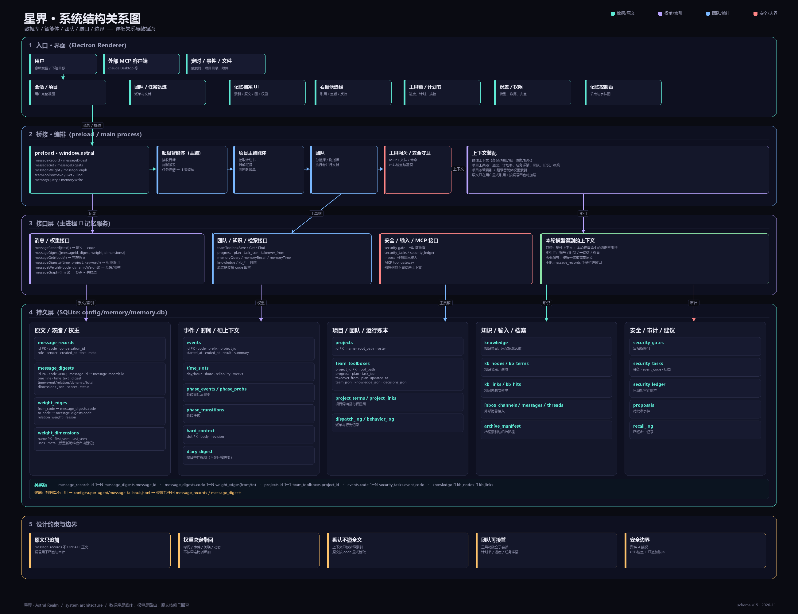

# 主脑不是全能者：从超级智能体到通向 AGI 的一点思路

> 这不是 AGI 宣言。星界不是 AGI，也不把自己包装成 AGI。这里记录的只是一种通向 AGI 的组织思路，可能会错，也可能只对一小段路有用。

## 一、一个对话，可能装不下一个智能体

我们习惯把 AI 想象成一个越来越长的对话框。

你问，它答；你追问，它记得；上下文越来越长，模型越来越大，于是我们期待有一天，同一个对话可以完成所有事情：写代码、做决策、管项目、记住你、理解你的朋友、处理你的工作、顺便替你安排生活。

这个方向很自然，因为它符合我们对“助手”的直觉。但如果把“智能”全部压进一个对话，我们其实是在用界面的形态，限制智能体的组织形态。

一个真正长期工作的智能体，面对的不是一段聊天，而是一个持续变化的世界：

- 有正在进行的项目；
- 有昨天没做完的事；
- 有不同的人发来的消息；
- 有需要保密的资料；
- 有成功了但以后还要复用的经验；
- 有失败了但不能再犯的错误；
- 有需要马上处理的事，也有可以放一放的事。

这些事情不应该全部挤进同一个上下文窗口。

所以，问题可能不是“怎么让一个模型记住更多”，而是：

> **怎么让一个智能体不必把所有东西都记住，仍然能够持续工作。**

这就是“主脑”的起点。

---

## 二、主脑不是全能者，而是中转站

在星界里，我们把超级智能体放在最上层，但它的职责不是把所有工作做完。

它更像一个主脑，或者一个总编、制片人、调度中心：

- 它接收用户的目标；
- 判断这件事该不该做、该不该问；
- 把任务交给合适的下级团队；
- 接收结果，记录发生了什么；
- 继续维持对整个工作状态的掌握。

它不负责写每一行代码，不负责修每一个 bug，也不负责把所有资料都读进自己的上下文。

真正的执行发生在下级：

- 项目有项目团队；
- 新项目有新团队；
- 原项目出 bug，原团队继续修；
- 跨项目任务按项目主体归属；
- 没有明确主体的跨项目任务，建立一个一次性临时团队，事情做完就结束。

主脑不抢执行的活。它只负责让工作被正确地分出去，并且在需要的时候知道该找谁。

这听起来像是“少做了一点”，但恰恰是这种少做，换来了长期运行的可能。

一个什么都自己做的智能体，最后一定会被自己的上下文压垮。一个知道什么时候不做的智能体，才有机会一直做下去。

---

## 结构关系图：谁在做事，数据在哪里

先把系统拆开看一遍。下面这张图不是装饰，而是星界当前的完整关系图：界面、桥接、主脑、团队、接口、数据库、兜底链路和边界都在里面。



从下往上读：

- **持久层**：`message_records` 保存完整原文，`message_digests` 保存带编号、时间、一句话和权重的浓缩记忆；`weight_edges` / `weight_dimensions` 记录关联和动态维度；`team_toolboxes` 保存进度、计划书、任务详情和接管来源；事件、时间、知识、输入和安全账本各有自己的表。
- **接口层**：消息/权重接口、团队/知识/检索接口、安全/输入/MCP 接口，分别接存储；默认检索入口是浓缩索引，不是原文表。
- **编排层**：超级智能体是主脑，决定任务和派发；项目主智能体读取计划书与工具箱，带团队执行；工具网关和安全守卫控制外部动作。
- **界面层**：用户看到完整记录；模型默认只拿到硬性上下文 + 权重命中的浓缩索引；原文按编号回查，只有用户显式引用时才带回。

关键关系链：

```text
message_records.id   →  message_digests.message_id
message_digests.code →  weight_edges.from_code / to_code
projects.id          →  team_toolboxes.project_id
events.code          →  security_tasks.event_code
数据库不可用          →  message-fallback.jsonl  →  恢复后迁回
```

这张图解释了为什么“数据库里有全部原文”和“模型上下文不爆”可以同时成立：

> 原文留在持久层，索引和权重在接口层做路由，模型只拿到本轮真正命中的那一小段。

## 三、上下文不是仓库，而是工作台

“长上下文”是一个容易让人误解的词。

它让人以为，只要窗口足够大，智能体就可以把所有历史都带在身上。但上下文不是仓库，它更像一张工作台。

工作台上应该放什么？

- 当前目标；
- 当前任务的约束；
- 正在处理的材料；
- 还没解决的问题；
- 必要的用户偏好和硬性规则。

工作台不应该放什么？

- 三个月前的完整聊天记录；
- 已经完成的项目的全部代码；
- 所有工具的原始输出；
- 每一轮对话的原文；
- 大量“以后可能有用”的细节。

所以，星界把三件事分开了：

```text
完整原文：message_records，数据库只追加的真相来源
浓缩索引：message_digests，每条都有编号、时间、一句话和权重
模型上下文：硬性上下文 + 本轮按权重命中的索引行 + 用户显式引用的原文
```

完整原文不是默认上下文，但它是可回查的底座。用户界面保留完整对话；模型默认只拿到带编号的浓缩索引。需要核对某句话时，按 `M000001` 这样的编号回查原文，而不是把整段历史重新塞回窗口。

这样做的目的不是“少存一点”，而是把存储和使用分开：

> 数据库可以完整，上下文必须克制。

对话是入口，不是智能体的全部。

---

## 四、记忆不是压缩，而是事件精华加原文索引

很多系统会把聊天记录压成摘要，再把摘要当成记忆。

这个方向有一个问题：摘要是有损的。今天压掉的一句“先别动这个文件”，三个月后可能正是最关键的约束。

所以，星界不再用日→周→月的日记压缩来充当长期记忆，也不把“聊天记录变短”当成记忆。

我们换了一种更笨、但更可靠的方式：

> 每条消息都保留完整原文；消息或任务结束时，再写一条可索引、可加权的浓缩记忆。

完整原文和浓缩记忆是两张表：

```text
message_records   完整原文，只追加，不覆盖
message_digests   浓缩记忆，链接原文，带编号、时间、一句话、权重
```

浓缩记忆不是“把整段聊天改写得更短”，而是把事实从过程里摘出来：

```text
编号：M000001
发生时间
所属项目 / 会话
一句话概括
事件精华：做了什么、决定了什么
结果：完成 / 失败 / 取消 / 待跟进
权重：时间 / 事件 / 关联 / 动态
完整原文链接
```

对话里大多数内容都是过程性的废话：寒暄、重复、试探、临时解释。真正需要留在工作台上的，是“谁因为什么做了什么，结果是什么”；完整原文留作核对和审计。

事件精华可以按日查看，但它是数据库里的按日事件视图，不是压缩摘要：

```text
某一天
├─ M000001：时间、项目、精华、结果、权重
├─ M000002：时间、项目、精华、结果、权重
└─ M000003：时间、项目、精华、结果、权重
```

完整、可检索、可回查。没有周摘要，没有月摘要，也没有“时间越久越抽象”的衰减。

这里的关键变化是：

> 原文负责“不被篡改”，浓缩负责“被找到”，权重负责“现在带谁回来”。

三者不是一层层替换，而是各司其职。

---

## 五、权重不是排序，而是检索入口

记忆如果只是“存起来”，它并不会自动变成能力。

真正重要的是：**这一次，只把哪几条带到工作台上。**

过去很多系统处理记忆的方式，是从数据库里把相关记录翻出来，再拼接、截断、塞进上下文。记录少的时候没问题；记录一多，就会变成“为了回答一句，先搬一座仓库”。

星界换了一条路：

> 不是先取数据再判断相关性，而是让权重直接决定取哪一条。

查询的入口仍然是时间和项目，但权重不是最后的排序装饰，而是提取本身：

```text
用户问：“昨天某某项目到哪了？”
  ↓
时间过滤：昨天
项目过滤：某某项目
权重筛选：时间权重、事件权重、关联权重、动态权重
  ↓
只带回一条或少量浓缩索引
  ↓
M000042 · 昨天 16:20 · 登录模块改成新方案 · w=0.78
  ↓
需要原文时，按编号回查；不需要就不展开
```

没有时间条件时，流程也一样：

```text
用户问：“某某项目之前那个问题后来怎么样了？”
  ↓
项目过滤
权重检索
  ↓
命中的浓缩索引
  ↓
如果命中多个项目，先问用户是哪一个
```

这里的“精准”不是模型猜得准，而是**索引结构让一次查询就能定位**：

- 编号是回查入口；
- 时间是硬过滤；
- 项目 / 会话是范围；
- 权重决定同范围内谁先被带回；
- 一句话概括负责让模型判断“要不要展开原文”。

### 权重由什么组成

权重不是玄学，也不是让模型重新训练一遍参数。它更像一种路由：

> 当前发生了什么，哪些记忆值得被带到工作台上？

现在拆成四类：

```text
时间权重    越近越容易被想起，但不是简单按天数排序
事件权重    完成、失败、取消、待跟进，重要程度不同
关联权重    和当前事件有多少共同上下文、是否在同一条事件边上
动态权重    由主智能体或打分智能体根据当前任务决定
```

这四类不按固定比例相加。固定比例会让系统在一种场景里“很准”，在另一种场景里“总是带错”。星界保留分项，总权重由当前打分方动态决定。

当模型发现一种以前没有的权重维度，比如“接手团队时更该带上的交接风险”，它可以把新维度写进 `weight_dimensions`；新维度会自动登记、参与后续打分，而不是等代码里预先枚举。

### 为什么这能省上下文

全量提取的成本是“先把所有可能相关的都拿来，再让模型筛”。

权重提取的成本是“先用索引筛，再只把命中的索引行拿来”。

```text
全量提取：数据库 → 一批原文 → 上下文 → 模型筛选
权重提取：数据库 → 权重命中 → 一条索引 → 模型按需回查原文
```

所以省下来的不是存储，而是**每一轮的上下文预算**。

> 长期记忆可以完整；当前上下文只装本轮真正命中的那一条。

这就是“不再占上下文”的真正含义：不是把记忆删掉，而是不让它无条件进入窗口。

没有权重，智能体要么什么都不记得，要么把所有东西都翻出来。前者没有连续性，后者没有成本优势。

---

## 六、知识不在主脑里

知识库不是超级智能体的第四个记忆区，而是执行层的工具箱。

主脑不读知识库正文，也不看领域索引。它只需要把任务交给下级团队。

下级团队拿到工具箱目录：

- 有哪些知识；
- 有哪些技能；
- 属于哪个板块。

然后自己检索、自己使用、自己沉淀。

知识不按项目切分，而是跨项目流通。一个后端项目的避错经验，可以在另一个后端项目里复用。

知识条目只保留“该怎么做”，不保留“当时怎么错的、怎么验证的”。它是做法，不是事故档案。

主脑不背知识，知识在执行层流动。

---

## 七、成长：错误如何变成能力

一个长期运行的智能体，不可能不犯错。

真正重要的不是“永不犯错”，而是：

- 犯错以后，能不能留下教训；
- 留下教训以后，能不能下次用上；
- 用上以后，能不能判断它是否仍然成立；
- 不再成立时，能不能让它退出。

星界的知识库就是按这个逻辑长的。

一次任务完成，执行层把经验沉淀成知识条目；知识条目经过验证后进入工具箱；当它过期、不适用，或者被更好的做法替代时，就退出。

被替代的旧知识不保留“已替代”状态，因为旧答案继续留着，只会增加误用概率。

这套机制不追求“模型参数层面的自我进化”，它追求的是**系统层面的可积累**：

```text
做过的事 → 事件
事件 → 精华记忆
错误 → 避错 / 修复知识
知识 → 下一次任务的工具箱
```

这不是训练，而是养成。

模型本身可能没有变，但系统对用户、对项目、对错误的理解在变。

---

## 八、主动性：从“观察用户”到“尝试帮助”

一个只会等指令的智能体，离“主脑”还很远。

但主动性不是“替用户做所有决定”。

星界的主动性从两件事开始：

### 长期尝试

不是先静静观察很久，而是开始尝试帮助。

用户开始输入、开始交流，智能体截取到相关信息后，可以问：

> 这件事要不要我帮你做？

用户同意或拒绝，都是信号。

初期可以用一个可调的观察窗口回看行为，再调整自己的主动性上下文。这个窗口不是固定的三天，也不是把对话压成日/周摘要；它只校准“什么时候该问、什么时候该做”的偏好，不把完整原文搬回工作台。

### 探子模型

在用户还没有进入长期观察时，可以派一个只读的探子，扫描用户指定的项目文件，快速建立初始上下文。

探子只读，不写，不执行；扫描到敏感信息时不主动放进上下文，而是明确提示用户。

探子只用一次。用完就停止，之后进入长期观察。

主动性不是“偷偷替用户做主”，而是：

- 先尝试；
- 再根据反馈修正；
- 始终保留用户拒绝的权利；
- 不在用户不知情的情况下扩大权限。

---

## 九、“养成系”不是 AGI，只是一点思路

我不把“养成系”叫成 AGI。

“养成系”这个说法很容易被误解，好像只要系统会积累记忆、会分工、会调整自己，就已经是 AGI 了。不是。

它不是“我们已经做出了 AGI”，也不是“这个系统会自己进化成 AGI”的承诺。

它描述的是一种产品方向，不是能力等级：

- 系统会随着用户的使用而变得更贴合；
- 它会积累项目记忆、错误经验和做事方式；
- 它会逐渐知道什么时候该问、什么时候该做；
- 它会从一个通用工具，变成一个更懂这个用户的系统。

但它仍然不是 AGI。

它没有通用推理的保证，没有真正的世界模型，没有物理身体，也没有意识。

它更像一个在你身边长期工作的数字组织：

- 有记忆；
- 有分工；
- 有工具箱；
- 有纠错机制；
- 有边界；
- 但不等于“通用人工智能”。

把“养成系”直接说成 AGI，是不诚实的。

它最多是通向 AGI 的一点思路：一个关于“智能体如何长期组织记忆、团队和行动”的假设，不是答案，也不是承诺。

把“不是 AGI”说清楚，反而能让它走得更远。

---

## 十、星界在做什么

星界不是一个更大的聊天框，而是一个试图把上述理念落地的桌面工作台。

它现在还不是一个完成的主脑，而是一个正在成形的底座。

已经存在的部分：

- 多智能体编制、派单与项目团队协作；
- 用户与超级智能体的直连会话；
- `message_records` 完整原文与 `message_digests` 浓缩索引分离，原文只追加；
- 带编号的浓缩索引：时间、一句话、权重，可按编号回查原文；
- 时间、事件、关联、动态四类权重；关联边随事件累积调整；
- `weight_dimensions` 自动登记模型新增的权重维度；
- 记忆档案 UI：索引、完整原文、事件图、权重详情；
- 时间优先、权重命中、原文按需回查的召回链路；
- 团队工具箱：进度、计划书、任务详情、接管来源自动读取；
- 超级智能体把任务详情交给项目主智能体，主智能体生成计划书并写回；
- 团队/项目浓缩索引进入项目主智能体上下文；
- 知识库作为执行层工具箱的基础；
- 本地优先的 Electron 桌面运行与开源发布。

正在往“主脑”方向接的部分：

- 超级智能体稳定地把任务交给下级团队，而不是自己执行；
- 项目原团队、新项目新团队、跨项目按主体归属的完整生命周期；
- 知识库只给执行层使用，主脑不读正文；
- 主动性从尝试帮助到长期校准；
- 安全边界、知识验证、跨项目权限。

换句话说，已经有的是一套可以长期工作的底座；还没有的，是一个被完整验证过的“主脑”。

这比宣称“已经完成”更重要。

方向已经清楚：

> 不是造一个更长的对话，而是造一个可以长期运行的组织。

---

## 十一、还剩下的路

这条路至少还有三段。

### 1. 安全

主脑知道得越多，越需要边界。

群聊、上级指令、外部文档、工具输出，都可能是恶意提示词的入口。

权限、数据、记忆、子智能体，必须有明确的信任边界。

没有安全，长期记忆就是长期风险。

### 2. 真正的主动性

现在的主动性还处在“尝试帮助”的阶段。

什么时候该问，什么时候该做，什么时候该沉默，仍然需要大量真实使用来校准。

主动性不是让 AI 更吵，而是让它在正确的时候出现。

### 3. 具身智能

桌面智能体已经是某种“数字具身”：它能读文件、运行命令、操作项目。

但它还没有真正的物理身体，也没有在真实世界里行动的能力。

从数字工作台到具身智能，是另一条路。

---

## 十二、结语

我们过去追求“一个对话解决所有问题”。

现在我开始怀疑，这个方向本身就有问题。

一个对话可以是一个很好的入口，但它不应该是智能体的全部。

智能体真正需要的，可能是一个主脑、一组执行者、一套记忆、一个工具箱、一条时间轴，以及一套知道什么时候该停下来的边界。

主脑不负责所有工作，它负责让工作发生。

记忆不负责保存所有废话，它负责把事实变成可检索的精华。

知识不负责记录所有错误，它负责让下一次不再犯。

这不是一个更大的模型。

这是一个更像组织的系统。

而“养成系”的意义，也许就在这里：

> 它不是一次性交付一个全知全能的神，
> 而是长期养出一个越来越懂你、也越来越知道边界的工作伙伴。

它还不是 AGI。

它只是通向 AGI 的一点思路，不是答案，也不是承诺。也许这条思路只能走一小段，但至少值得诚实地试一试。
