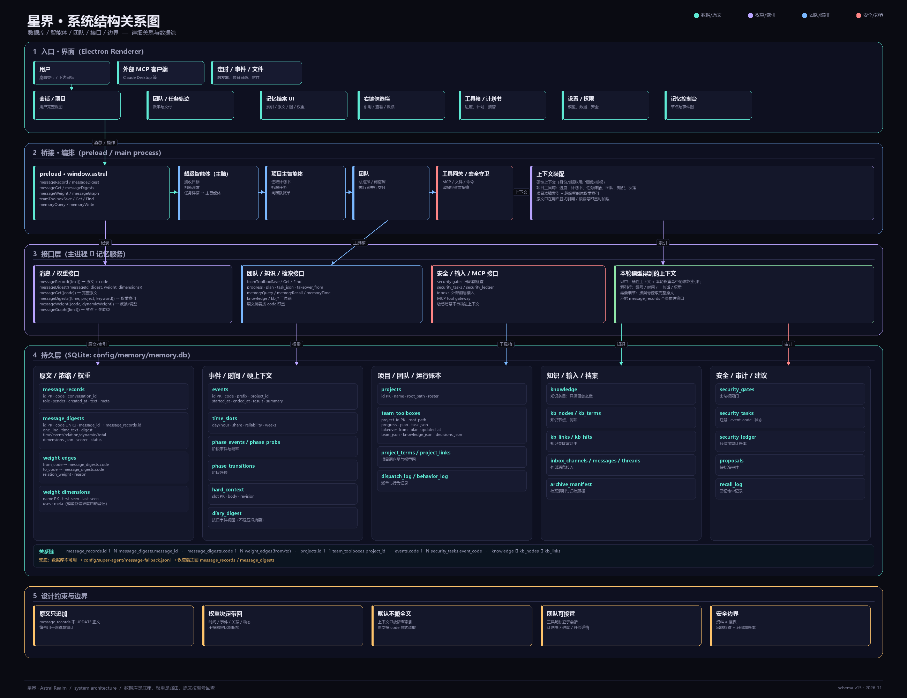

# 星界简介

## 一句话

星界是一个可编组、可换模型、可共享上下文的 AI 协作桌面工作台。

## 短介绍（约 60 字）

星界把 AI 从单聊天框变成一支可任免的团队：划分编制、拆解任务、并行执行，任务轨迹实时可见。

## 长介绍（约 180 字）

星界不是一个更大的聊天框，而是一张可以随时重组的协作工作台。你划分编制、选择模型、绑定技能；总指挥拆解目标，副指挥与执行者并行推进，右侧任务轨迹实时展示每一步交付。

单独对话、团队协作、插件制作三种会话彼此隔离；每个成员可以独立绑定模型、提示词、技能和上下文。主题、MCP、插件与提示词均可定制，前端零构建，MIT 开源。

## 系统结构关系图



从下往上看：

- **持久层**：原文、浓缩索引、权重边、动态维度、事件、时间、项目团队、知识、输入和安全账本分开存；
- **接口层**：消息、权重、团队工具箱、知识、安全和 MCP 各有明确入口；
- **编排层**：超级智能体决定任务，项目主智能体写计划并带团队执行；
- **界面层**：用户看到完整记录，模型默认只拿权重命中的浓缩索引，原文按编号回查。

关键关系链：

```text
message_records.id  →  message_digests.message_id
message_digests.code →  weight_edges.from_code / to_code
projects.id          →  team_toolboxes.project_id
events.code          →  security_tasks.event_code
```

数据库不可用时先写 `message-fallback.jsonl`，恢复后迁回。

## GitHub 仓库 About

```text
多 Agent、多模型的协作桌面工作台：划编制、拆任务、并行交付。
```

## GitHub Topics

```text
multi-agent, llm, electron, ai, desktop, javascript, productivity
```

## 亮点

- 多 Agent 编制：总指挥 / 副指挥 / 执行者，可增删改。
- 多模型：每个成员独立绑定供应商和模型。
- 任务轨迹：拆解、派单、执行、验收实时可见。
- 会话隔离：单独对话 / 团队协作 / 插件制作，各自独立保存。
- 丰富消息：表格、可复制代码块、Mermaid 示意图。
- 上下文与技能：项目级、成员级、通用技能可分别管理；项目上下文交给总指挥、成员上下文各自沉淀，一键从会话里提炼。
- 提示词强化：结合最近会话上下文预览后再应用。
- 轻量开源：零构建前端、Electron 桌面壳、MIT 许可。

## 截图

- `docs/preview.png`：团队协作主界面与任务轨迹
- `docs/modes.png`：三种对话模式
- `docs/rich-content.png`：表格、代码块与示意图
- `docs/social-preview.png`：GitHub Social Preview（1280×640）
